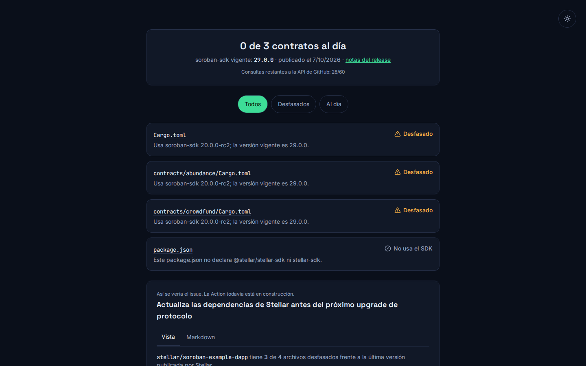

# Documentación — Semana 3

**Semana 3, Blockchain Builders 101 (BAF) · Soroready**

## Front construido

Front publicado: https://soroready.xyz

El PR #1 agrega `frontend/`, una single-page app construida con Vite,
React y TypeScript. La interfaz es deliberadamente mínima: un campo de
texto donde el mantenedor escribe su repo como `owner/repo` (por ejemplo
`stellar/rs-soroban-sdk`) y un botón "Revisar". No hay backend propio —
toda la lógica corre en el navegador y habla directo con la API de
GitHub.

Al enviar el formulario, la app dispara dos peticiones en paralelo con
`Promise.all`: una pide el contenido de `Cargo.toml` del repo indicado
vía la API de contenidos de GitHub, y la otra pide el último release de
`stellar/rs-soroban-sdk`. El contenido de `Cargo.toml` llega en base64 y
se decodifica con `atob`; de ahí se extrae la versión declarada de
`soroban-sdk` con una expresión regular que reconoce tanto
`soroban-sdk = "x.y.z"` como la forma con tabla (`{ version = "x.y.z" }`).
La versión vigente no está hardcodeada en ningún lado: se lee del
`tag_name` del release más reciente en GitHub en el momento de la
consulta.

Ambas versiones se normalizan (se les quita el prefijo `v`) y se
comparan número por número, sin depender de una librería de semver. Si
la versión del repo es menor que la vigente, la app marca el resultado
como "Desfasado"; si es igual o mayor, como "Al día". Para los casos de
error — formato de `owner/repo` inválido, repo sin `Cargo.toml` (o
privado/inexistente), o falla de red al consultar la API — la app
muestra un mensaje específico en vez de un error genérico.

Cuando hay un resultado válido (al día o desfasado), la app construye el
texto exacto del issue que la futura GitHub Action abriría: título,
versión actual del repo, versión vigente, link directo al release/
changelog, y una línea explícita de que "Soroready es informativo: no
modifica tu código ni tus fondos". Ese texto se puede copiar al
portapapeles con un botón, para revisarlo antes de que exista la
automatización real.

Esto conecta directo con los pasos 2 a 4 del flujo del Blueprint: el
paso 2 (la Action lee `Cargo.toml`/`package.json`) se replica aquí del
lado del cliente leyendo `Cargo.toml` vía la API de contenidos en vez de
clonar el repo; el paso 3 (comparar contra la versión vigente verificada
en vivo, no un valor fijo desactualizado) es exactamente lo que hace la
consulta al release más reciente de `rs-soroban-sdk`; y el paso 4 (abrir
o actualizar un issue con el diagnóstico) queda prevalidado como vista
previa de texto, antes de que la Action lo automatice de verdad. El
frontend sirve entonces como prototipo de la lógica de diagnóstico y de
la redacción del issue, separado de la pieza que todavía falta: la
Action que de verdad lo publique en GitHub.

### Capturas

: el resultado con
`stellar/soroban-examples`, 10 contratos comparados contra la versión
vigente y la vista previa del issue.

## Decisión técnica

**Opción B.** Soroready no tiene lógica en la cadena: el radar vive
fuera de cualquier contrato, como Action + frontend que leen manifests y
consultan releases públicos de GitHub. El contrato demo que se usará en
testnet no es código propio de Soroready, sino un ejemplo oficial
tomado de `stellar/soroban-examples`, compilado y desplegado
intencionalmente con una versión vieja de `soroban-sdk` para que el
radar lo detecte como desfasado en vivo durante el Demo Day.

El despliegue en testnet se hace con el Stellar CLI (`stellar contract
build` / `stellar contract deploy`), sin pasar por un backend ni una
llave custodiada por Soroready — el objetivo del contrato es solo ser
un blanco real y verificable para la detección, no demostrar una
capacidad de contratos propia. Las versiones vigentes que usa el radar
(tanto en el frontend como, después, en la Action) salen siempre de los
releases oficiales de Stellar en GitHub (`stellar/rs-soroban-sdk`,
`stellar/js-stellar-sdk`), consultados en el momento, nunca de un número
fijo en el código. Esto mantiene a Soroready como un observador: lee,
compara y avisa, pero nunca toca fondos, llaves ni el contrato que
audita.

Decidimos no construir un contrato propio porque no le suma nada a lo
que el radar necesita demostrar. Soroready no audita lógica de
contratos: audita una dependencia declarada en un manifest. Un contrato
hecho desde cero solo para tener algo desplegado en testnet sería código
nuestro que mantener, probar y defender el día de la demo, sin dar
ninguna señal distinta a la que ya da un ejemplo real del ecosistema.
Usar un ejemplo oficial de `stellar/soroban-examples` cumple la misma
función — un contrato real, compilado con una versión vieja de
`soroban-sdk`, detectable en vivo — sin inventar superficie de código
propio ni salirnos del alcance del MVP que ya fijamos en el Product
Blueprint de la Semana 2, donde el contrato demo queda explícitamente
como pieza de detección, nunca como producto en sí mismo. Es la misma
lógica detrás de que Soroready nunca toque fondos ni llaves: tener
nuestro propio contrato no haría esa promesa más creíble, solo más
código que cuidar.

## Participación del equipo

- **Mau Guillén** (`mawyguillen-cpu`): README, documentación e
  integración.
- **Luis López** (`LuisLopez1910`): construyó el frontend en Vite +
  React + TypeScript que compara versiones de `soroban-sdk` y muestra la
  vista previa del issue.

Mentoría: (Eras256) acompañó al equipo en las semanas 1 y 2, configuró
el repositorio inicial y nos ayudó a armar los primeros documentos. El
trabajo de la semana 3 es del equipo.

## Bloqueos y siguiente paso

La Action todavía no existe. Siguiente paso: contrato demo en testnet y
la Action.
