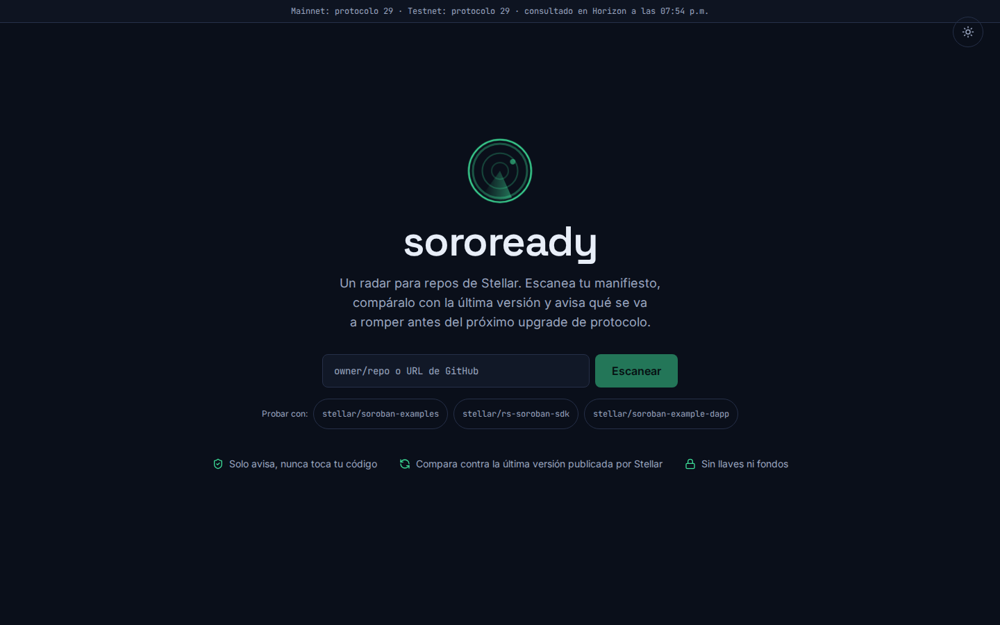
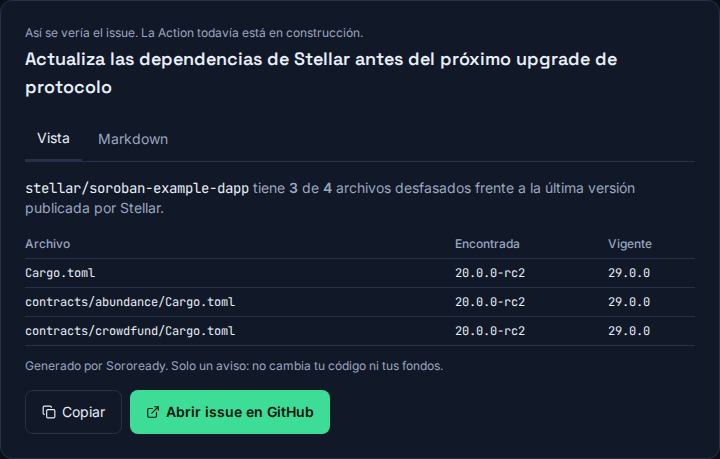
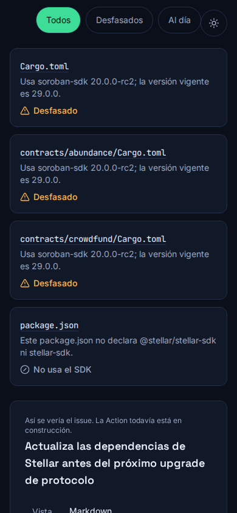
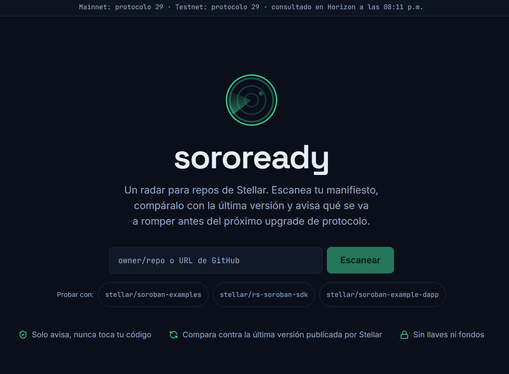
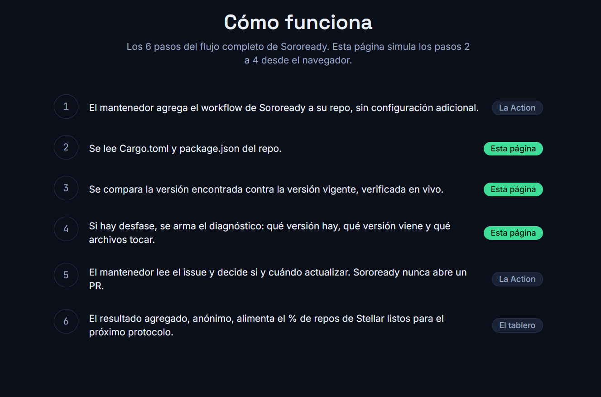
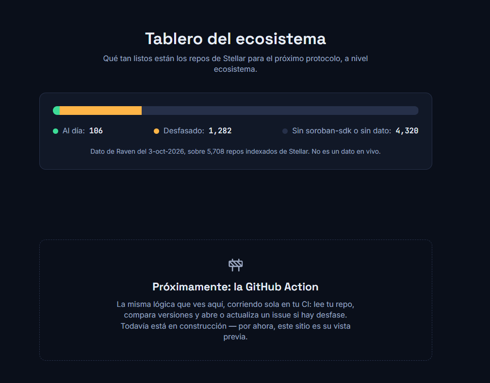

# Documentación — Semana 3

**Semana 3, Blockchain Builders 101 (BAF) · Soroready**

## Front construido

Front publicado: https://soroready.xyz

El PR #3 reescribe `frontend/` a nivel producto, con Tailwind v4,
`motion` y `lucide-react`: hero con radar SVG animado, identidad de
marca (paleta oscura/clara con contraste AA verificado, favicon propio)
y 100% responsive de 360 a 1920px. El escaneo ahora cubre `Cargo.toml`
(incluido `{ workspace = true }`) y `package.json`
(`@stellar/stellar-sdk` y el nombre viejo `stellar-sdk`) en subcarpetas,
con la versión vigente de `soroban-sdk`/`js-stellar-sdk` y el protocolo
de Horizon en vivo, cacheado 10 min por repo y mostrando el cupo
restante de la API de GitHub. El resultado trae filtros, semáforo con
icono+texto, y vista previa del issue con pestañas Vista/Markdown y
"Abrir issue en GitHub" prellenado. Se agregó la línea de tiempo de los
6 pasos del Blueprint, el tablero del ecosistema (dato de Raven, marcado
como no-en-vivo) y la sección de la Action en construcción.

La interfaz se armó en componentes separados (`frontend/src/components/`):
`Hero` con el formulario de escaneo y tres repos de ejemplo listos para
probar con un clic; `ProtocolBanner`, que muestra el protocolo vigente
de mainnet y testnet consultado en vivo contra Horizon; `ScanSection` y
`FileCard`, que listan cada manifiesto encontrado con su estado (al día,
desfasado, error, o "no usa el SDK") en un semáforo con ícono y texto, y
permiten filtrar por "Todos", "Desfasados" o "Al día"; `IssuePreview`,
con las pestañas de vista renderizada y Markdown crudo, botón de copiar,
y un link que abre el issue ya prellenado en GitHub; `HowItWorks`, con
los 6 pasos completos del flujo del Product Blueprint (marcando cuáles
corre esta página y cuáles corren en la Action o el tablero);
`EcosystemBoard`, con la barra del % de repos de Stellar listos según el
dato de Raven del 3-oct-2026, explícitamente etiquetado como no-en-vivo;
y `ActionComingSoon`, que deja claro que la Action todavía no existe y
que este sitio es su vista previa.

La lógica de escaneo vive en `frontend/src/lib/`. `manifiestos.ts`
extrae la versión de `soroban-sdk` de un `Cargo.toml` tanto en forma de
string (`soroban-sdk = "x.y.z"`) como de tabla
(`{ version = "x.y.z" }` o `{ workspace = true }`, heredando entonces la
versión real de la sección `[workspace.dependencies]` del `Cargo.toml`
raíz), y la versión de `@stellar/stellar-sdk` (o su nombre viejo,
`stellar-sdk`) de un `package.json`. `github.ts` recorre el árbol del
repo con la API de Git Trees, encuentra hasta 20 `Cargo.toml` y 10
`package.json` en cualquier subcarpeta, cachea cada resultado por repo
10 minutos para no gastar cupo de más, y expone en cada respuesta cuánto
cupo le queda a la API de GitHub (`x-ratelimit-remaining`/`-limit`).
`horizon.ts` consulta en paralelo `horizon.stellar.org` y
`horizon-testnet.stellar.org` para el protocolo vigente real, no un
número fijo. `issue.ts` arma el título, el cuerpo en Markdown y la URL
prellenada de `github.com/.../issues/new` a partir del resultado del
escaneo, recortando el texto si pasa de ~7,000 caracteres para que quepa
en un issue real.

Esto sigue conectando con los pasos 2 a 4 del flujo del Blueprint: el
paso 2 (leer `Cargo.toml`/`package.json`) ahora cubre subcarpetas y los
dos ecosistemas (Rust y JS/TS); el paso 3 (comparar contra la versión
vigente verificada en vivo) corre contra el release real de
`rs-soroban-sdk`/`js-stellar-sdk` y, además, contra el protocolo real de
Horizon; y el paso 4 (abrir o actualizar un issue con el diagnóstico)
queda prevalidado con la vista previa completa — título, cuerpo,
Markdown y el link para abrirlo de verdad en GitHub —, antes de que la
Action automatice ese mismo paso. La Action en sí sigue sin existir;
`ActionComingSoon` lo dice explícitamente en la propia interfaz.

### Capturas

: la página de inicio con el hero, el
campo owner/repo y el botón Escanear.

: el resultado de escanear
`stellar/soroban-example-dapp`, con el semáforo de cada manifiesto
encontrado, los filtros por estado y el cupo restante de la API de
GitHub.

: la vista previa del issue, con sus
pestañas de Vista y Markdown y el botón para abrirlo en GitHub.

: el mismo resultado de diagnóstico en una
pantalla angosta, con filtros y semáforo apilados — responsive desde
360px.

: el hero con el
radar, la franja del protocolo vigente en mainnet y testnet (Horizon,
en vivo) y los repos de ejemplo.

: los 6 pasos del flujo,
marcando cuáles hace esta página, cuáles la Action y cuál el tablero.

: el tablero del
ecosistema con el dato de Raven del 3-oct-2026 (marcado como no en
vivo) y la sección de la Action en construcción.

## Decisión técnica

**Opción B.** Soroready no tiene lógica en la cadena: el radar vive
fuera de cualquier contrato, como Action + frontend que leen manifests y
consultan releases públicos de GitHub. El contrato demo que se usará en
testnet no es código propio de Soroready, sino un ejemplo oficial
tomado de `stellar/soroban-examples`, compilado y desplegado
intencionalmente con una versión vieja de `soroban-sdk` para que el
radar lo detecte como desfasado en vivo durante el Demo Day.

El despliegue en testnet se hace con el Stellar CLI (`stellar contract
build` / `stellar contract deploy`), sin pasar por un backend ni una
llave custodiada por Soroready — el objetivo del contrato es solo ser
un blanco real y verificable para la detección, no demostrar una
capacidad de contratos propia. Las versiones vigentes que usa el radar
(tanto en el frontend como, después, en la Action) salen siempre de los
releases oficiales de Stellar en GitHub (`stellar/rs-soroban-sdk`,
`stellar/js-stellar-sdk`), consultados en el momento, nunca de un número
fijo en el código. Esto mantiene a Soroready como un observador: lee,
compara y avisa, pero nunca toca fondos, llaves ni el contrato que
audita.

Decidimos no construir un contrato propio porque no le suma nada a lo
que el radar necesita demostrar. Soroready no audita lógica de
contratos: audita una dependencia declarada en un manifest. Un contrato
hecho desde cero solo para tener algo desplegado en testnet sería código
nuestro que mantener, probar y defender el día de la demo, sin dar
ninguna señal distinta a la que ya da un ejemplo real del ecosistema.
Usar un ejemplo oficial de `stellar/soroban-examples` cumple la misma
función — un contrato real, compilado con una versión vieja de
`soroban-sdk`, detectable en vivo — sin inventar superficie de código
propio ni salirnos del alcance del MVP que ya fijamos en el Product
Blueprint de la Semana 2, donde el contrato demo queda explícitamente
como pieza de detección, nunca como producto en sí mismo. Es la misma
lógica detrás de que Soroready nunca toque fondos ni llaves: tener
nuestro propio contrato no haría esa promesa más creíble, solo más
código que cuidar.

## Participación del equipo

- **Mau Guillén** (`mawyguillen-cpu`): README, documentación e
  integración.
- **Luis López** (`LuisLopez1910`): construyó el frontend v1 y luego lo
  reescribió a nivel producto (front v2) en Vite + React + TypeScript
  con Tailwind v4, `motion` y `lucide-react` — escaneo de `Cargo.toml`/
  `package.json` en subcarpetas, protocolo de Horizon en vivo,
  identidad de marca, y la vista previa del issue con pestañas
  Vista/Markdown.

Mentoría: (Eras256) acompañó al equipo en las semanas 1 y 2, configuró
el repositorio inicial y nos ayudó a armar los primeros documentos. El
trabajo de la semana 3 es del equipo.

## Bloqueos y siguiente paso

La Action todavía no existe. Siguiente paso: contrato demo en testnet y
la Action.
